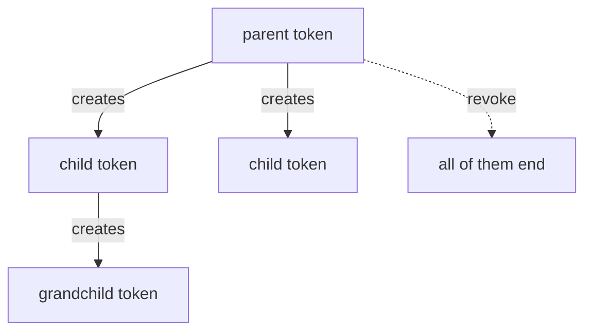

# The Token Lifecycle

Every request to OpenBao carries a token, and every token has a lifetime. A script that logs in once and runs for hours will one day send an expired token and get `permission denied`. This part shows how to read a token's lifetime, extend it, create a limited token for a job, and end a token on purpose.

The commands below need the port-forward from a second terminal (`kubectl -n openbao port-forward svc/openbao 8200:8200`), `BAO_ADDR` set to `http://openbao.localtest.me:8200`, and the lab-only root token in `ROOT_TOKEN`:

```sh
export BAO_ADDR=http://openbao.localtest.me:8200
export ROOT_TOKEN="$(kubectl -n openbao get secret openbao-init -o jsonpath='{.data.root-token}' | base64 -d)"
```

## Reading a token

A token is an object that OpenBao stores. Its fields tell you how long it lives, how often it can be used and what it may do. The endpoint `auth/token/lookup-self` returns those fields for the token that sends the request. Log in as `deployer` and look at the token:

<!-- astrona:playground:renew -->

```sh
DEPLOYER_TOKEN="$(curl -s -X POST --data '{"password":"deployer-password"}' \
  "$BAO_ADDR/v1/auth/userpass/login/deployer" | jq -r '.auth.client_token')"
curl -s -H "X-Vault-Token: $DEPLOYER_TOKEN" "$BAO_ADDR/v1/auth/token/lookup-self" \
  | jq '.data | {policies, ttl, creation_ttl, renewable, num_uses, type, display_name}'
```

`policies` lists `default` and `inventory-writer`. `ttl` is the number of seconds left, and `creation_ttl` is the lifetime the token started with. `renewable` is `true` when the token can be extended. `num_uses` is `0`, which means unlimited. `type` is `service`, the normal kind of token that OpenBao stores and can renew. Any token may call `lookup-self` because the `default` policy allows it.

## Renewing a token

Renewing resets the countdown of a token. The token asks for it with `auth/token/renew-self`, and the optional `increment` field says how long it wants to live from now. OpenBao treats the increment as a request and never grants more than the maximum TTL of the mount or the system:

```sh
curl -s -X POST -H "X-Vault-Token: $DEPLOYER_TOKEN" --data '{"increment":"30m"}' \
  "$BAO_ADDR/v1/auth/token/renew-self" | jq '.auth | {lease_duration, renewable}'
```

The answer has the new lifetime in `auth.lease_duration`, in seconds. OpenBao Agent and OpenBao Proxy do this on their own; a script that runs for a long time must do it too, or log in again.

## Creating a limited token

A job rarely needs everything its creator can do. The endpoint `auth/token/create` makes a child token with its own policies, lifetime and use limit. The creator needs the `create` and `update` capabilities on that path, and a child token can only get policies its parent already has. Root has every policy, so the root token can make a token that only reads the inventory:

```sh
CHILD="$(curl -s -X POST -H "X-Vault-Token: $ROOT_TOKEN" \
  --data '{"policies":["inventory-lister"],"ttl":"15m","num_uses":3,"display_name":"report-job"}' \
  "$BAO_ADDR/v1/auth/token/create")"
printf '%s' "$CHILD" | jq '.auth | {policies, lease_duration, accessor}'
CHILD_TOKEN="$(printf '%s' "$CHILD" | jq -r '.auth.client_token')"
```

The child has the policies `default` and `inventory-lister`, because OpenBao adds `default` unless the request sets `no_default_policy`. `num_uses` of `3` means the token works for three requests and OpenBao revokes it after the third. The `accessor` is a second identifier for the token. It lets an administrator look up or revoke the token without ever seeing the token itself.

Use the token three times and watch it end:

```sh
for attempt in 1 2 3 4; do
  curl -s -o /dev/null -w "attempt $attempt: HTTP %{http_code}\n" \
    -H "X-Vault-Token: $CHILD_TOKEN" "$BAO_ADDR/v1/auth/token/lookup-self"
done
```

The first three attempts return `200` and the fourth returns `403`, because the token no longer exists. Without a use limit, a token that leaks stays useful until its TTL ends, so a short TTL and a small `num_uses` limit the damage.

## Revoking tokens and the parent relationship

A token can end itself with `auth/token/revoke-self`. An administrator can end any token by its accessor with `auth/token/revoke-accessor`. OpenBao revokes the children of a token together with it:



The diagram shows that revoking the parent also ends every child and grandchild. An orphan token has no parent, so a revoked parent does not affect it. The endpoint `auth/token/create-orphan` makes one, and so does `"no_parent": true` on a create request from a token with the right rights.

Two more kinds of token matter. A batch token (`"type":"batch"`) is a small encrypted blob that OpenBao does not store. It cannot be renewed and has no accessor, which makes it cheap for very many short jobs. A periodic token is made with a `period` by a root or `sudo` caller. It has no maximum TTL: each renewal resets its TTL to the period, so a service that renews in time can keep one token for as long as it runs.

You can now read a token's lifetime, renew it, create a limited child token and end it. The open question is what that token is allowed to do on a given path.

## Common pitfalls

> [!WARNING]
> - **Reading `ttl` as the age.** `ttl` is the time left. `creation_ttl` is the starting lifetime.
> - **Asking for a bigger TTL than the maximum.** OpenBao caps the lifetime silently. Compare `lease_duration` with what you asked for.
> - **Testing a token with `num_uses` by looking it up.** Every request, including `lookup-self`, uses one.
> - **Creating a child with a policy the parent lacks.** OpenBao refuses the request. Check the parent's policies first.

## Your mission: Issue A Limited Token For A Reporting Job

You can now create a token with a fixed lifetime, use limit and policy. The mission asks you to issue such a token for a reporting job and hand it over in a Kubernetes Secret.

The lab runs in its own cluster, so first pause your playground. Nothing in it is lost:

```sh
astrona stop ats-116-playground-010-02
```

Then start the lab:

```sh
astrona run --git ssh://git@github.com/astrona-io/ATS116.git -c sections/section-010/module-02/labs/lab-01
```

The task is on the next page. Solve it on your own first. When you think you are done, send it for grading:

```sh
astrona submit -c sections/section-010/module-02/labs/lab-01
```

When the lab is done, remove it and start your playground again:

```sh
astrona destroy ats-116-lab-010-02
astrona start ats-116-playground-010-02
```
