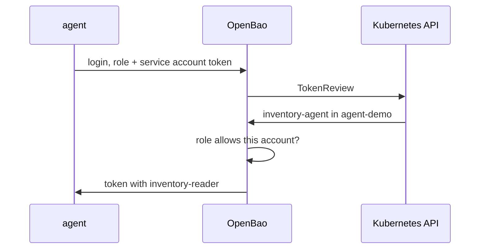

# Auto-Auth And Sinks

Before the agent can read a secret, it needs a token, and it must get that token without anyone typing a password into the pod. It also has to keep the token alive for as long as the pod runs. This part looks at the piece of the agent that does this, auto-auth, and at where the agent keeps the token it gets.

## The agent's configuration file

OpenBao Agent reads one configuration file in HCL, the HashiCorp Configuration Language that OpenBao's server configuration also uses. In this playground the file comes from the ConfigMap `agent-config`. Print it:

<!-- astrona:playground:renew -->

```sh
kubectl -n agent-demo get configmap agent-config -o jsonpath='{.data.agent\.hcl}'
```

The file has four stanzas, and each one is one job:

| Stanza | What it does |
| --- | --- |
| `vault` | Where OpenBao is: `address = "http://openbao.openbao.svc:8200"`. The name is kept from Vault for compatibility |
| `auto_auth` | How the agent logs in (`method`) and where it writes the token (`sink`) |
| `template_config` | Settings for all templates, such as how often to read static secrets again |
| `template` | One file to render: a template and a `destination` path |

The container starts the agent with `bao agent -config=/etc/openbao-agent/agent.hcl`. The image is the normal OpenBao image; `bao agent` is a mode of the same binary that runs the server.

## How the agent logs in

Auto-auth is the agent's login loop. A `method` stanza says which auth method to use, and the agent logs in again on its own whenever the token cannot be renewed any more. Here the method is `kubernetes` with the role `inventory-agent`.

The Kubernetes auth method logs a pod in with its service account token. Kubernetes mounts that token into every pod at `/var/run/secrets/kubernetes.io/serviceaccount/token`. The agent sends it to OpenBao, OpenBao asks the Kubernetes API whether the token is valid and which service account it belongs to, and then checks the role:



The diagram shows the agent sending the pod's service account token to OpenBao, OpenBao checking it with a TokenReview, and the role turning it into an OpenBao token. Read the role to see what it allows:

```sh
export BAO_ADDR=http://openbao.localtest.me:8200
export BAO_TOKEN="$(kubectl -n openbao get secret openbao-init -o jsonpath='{.data.root-token}' | base64 -d)"
bao read auth/kubernetes/role/inventory-agent
```

This needs the port-forward from a second terminal: `kubectl -n openbao port-forward svc/openbao 8200:8200`. The role binds the service account name `inventory-agent` in the namespace `agent-demo` to the policy `inventory-reader`. A pod with any other service account, or in any other namespace, is refused, even with the right role name.

## Where the token goes

A sink is a place where auto-auth writes the token after every login. The `file` sink writes it to a path inside the agent's container; here `/home/openbao/agent/token`, on an in-memory volume. Check that the agent logged in and wrote it:

```sh
kubectl -n agent-demo logs deploy/inventory -c agent | tail -n 20
kubectl -n agent-demo exec deploy/inventory -c agent -- ls -l /home/openbao/agent/token
```

The log shows the auth handler authenticating and the sink writing the token; the file exists, and its permissions keep other users of the container from reading it. The templates in the same agent use the token directly, so a sink is only needed when another process must use the token. This one is there so you can look at it.

Find out what the token can do. Read it from the sink and look it up:

```sh
AGENT_TOKEN="$(kubectl -n agent-demo exec deploy/inventory -c agent -- cat /home/openbao/agent/token)"
bao token lookup "$AGENT_TOKEN"
```

`policies` lists `default` and `inventory-reader`, and `ttl` counts down from one hour. The agent renews the token before it expires, and logs in again when renewal is no longer possible, so the application never sees an expired token. The volume is `emptyDir` with the default medium, and the token never leaves the pod.

You now know how the agent logs in without a password, which Kubernetes objects and OpenBao role that depends on, and where the token goes. The token is only half the job: the open question is how the agent turns it into the file the application reads.

## Common pitfalls

> [!WARNING]
> - **Binding the role to the wrong service account or namespace.** The login fails with `permission denied` even though the role name is right. Compare `kubectl get pod -o jsonpath='{.spec.serviceAccountName}'` with the role.
> - **Using the `default` service account.** Every pod without its own account shares it. Give the application its own account and bind only that one.
> - **Copying the sink token into a ConfigMap or an environment variable.** That turns a short-lived, renewed token into a static secret anyone can read.
> - **Reading the agent's log only once.** A login that failed at start is retried; read the last lines again after a fix.
