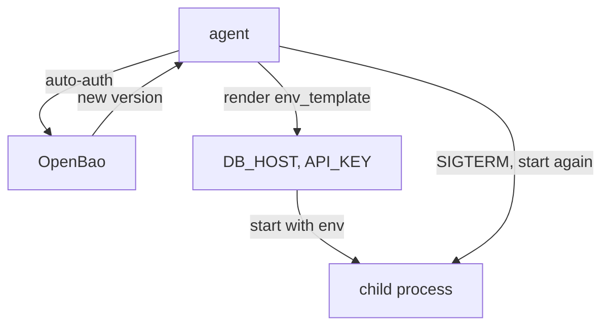

# Secrets As Environment Variables With Process Supervisor Mode

Many programs do not read a configuration file. They read environment variables at start, for example `DB_HOST` and `API_KEY`, and never look again. A file that changes while the program runs does nothing for them. OpenBao Agent has a second mode for these programs: it starts the program itself, with the secrets as its environment variables, and restarts it when a secret changes.

The commands below need the port-forward in a second terminal (`kubectl -n openbao port-forward svc/openbao 8200:8200`), `BAO_ADDR=http://openbao.localtest.me:8200`, and the lab-only root token in `BAO_TOKEN`.

## How process supervisor mode works

Process supervisor mode means the agent runs one child process, set in an `exec` stanza, and passes it environment variables built from `env_template` stanzas. Each `env_template` stanza is named after the variable it sets and holds a template in the same language as file templates. The agent renders all of them, then starts the child.



The diagram shows the agent rendering the variables, starting the child with them, and restarting the child when a secret changes. The mode has two rules: it needs exactly one `exec` stanza and at least one `env_template`, and it cannot be combined with file `template` stanzas in the same agent.

## Running a program this way

The program here is a small shell command that prints the database host and whether an API key is set, then waits. It runs inside the agent's container, because the agent starts it. Save this as `deployment-env-demo.yaml`:

<!-- astrona:playground:renew -->

```yaml
apiVersion: v1
kind: ConfigMap
metadata:
  name: env-demo-agent-config
  namespace: agent-demo
data:
  agent.hcl: |
    vault {
      address = "http://openbao.openbao.svc:8200"
    }

    auto_auth {
      method "kubernetes" {
        mount_path = "auth/kubernetes"
        config = {
          role = "inventory-agent"
        }
      }
    }

    template_config {
      static_secret_render_interval = "15s"
    }

    env_template "DB_HOST" {
      contents             = "{{ with secret \"secret/data/inventory/config\" }}{{ .Data.data.db_host }}{{ end }}"
      error_on_missing_key = true
    }

    env_template "API_KEY" {
      contents             = "{{ with secret \"secret/data/inventory/config\" }}{{ .Data.data.api_key }}{{ end }}"
      error_on_missing_key = true
    }

    exec {
      command                   = ["sh", "-c", "echo started with DB_HOST=$DB_HOST API_KEY_SET=${API_KEY:+yes}; sleep 3600"]
      restart_on_secret_changes = "always"
    }
---
apiVersion: apps/v1
kind: Deployment
metadata:
  name: env-demo
  namespace: agent-demo
spec:
  replicas: 1
  selector:
    matchLabels:
      app: env-demo
  template:
    metadata:
      labels:
        app: env-demo
    spec:
      serviceAccountName: inventory-agent
      containers:
        - name: agent
          image: quay.io/openbao/openbao:2.7.1
          command: ["bao", "agent", "-config=/etc/openbao-agent/agent.hcl"]
          volumeMounts:
            - name: agent-config
              mountPath: /etc/openbao-agent
      volumes:
        - name: agent-config
          configMap:
            name: env-demo-agent-config
```

Apply it:

```sh
kubectl apply -f deployment-env-demo.yaml
```

Then check the result. The child's output goes to the agent's log, because the agent passes the child's standard output through:

```sh
kubectl -n agent-demo rollout status deployment/env-demo
kubectl -n agent-demo logs deploy/env-demo | grep 'started with'
```

The line shows `DB_HOST=postgres.inventory.svc` and `API_KEY_SET=yes`. The program never saw a token and never called OpenBao; it got two ordinary environment variables. The page prints only whether the key is set, not its value, because a program's environment ends up in logs easily.

## A secret changes, the program restarts

Write a new database host and wait for the render interval:

```sh
bao kv patch secret/inventory/config db_host=postgres-replica.inventory.svc
sleep 20
kubectl -n agent-demo logs deploy/env-demo | grep 'started with'
```

A second `started with` line shows the new host. With `restart_on_secret_changes = "always"`, the agent sent the child `SIGTERM` (the signal in `restart_stop_signal`), waited for it to stop, and started it again with the new variables. The pod and the agent kept running; only the child process was replaced. Set the host back afterwards with `bao kv patch secret/inventory/config db_host=postgres.inventory.svc`, because the other examples in this module expect it.

Choose this mode only when the program cannot read a file. A restart drops the program's connections and in-memory state, and a program that must not restart can set `restart_on_secret_changes = "never"`, but then it keeps the old value until something else restarts it.

You can now deliver the same secret as a file or as environment variables, and you know how each one reacts to a new version: the file is rewritten, the program is restarted. Both ways need the agent to log in, render and stay healthy next to every application.

## Common pitfalls

> [!WARNING]
> - **Mixing `env_template` and file `template` stanzas.** Process supervisor mode does not allow both in one agent; run two agents or pick one mode.
> - **Printing secret values to check them.** Environment variables leak into logs and crash reports. Check that a variable is set, not its value.
> - **Expecting a running program to see a new value.** Environment variables are read at start. The agent must restart the child, or the program keeps the old value.
> - **Leaving the default render interval.** KV version 2 secrets are read again only every five minutes unless `static_secret_render_interval` says otherwise.
