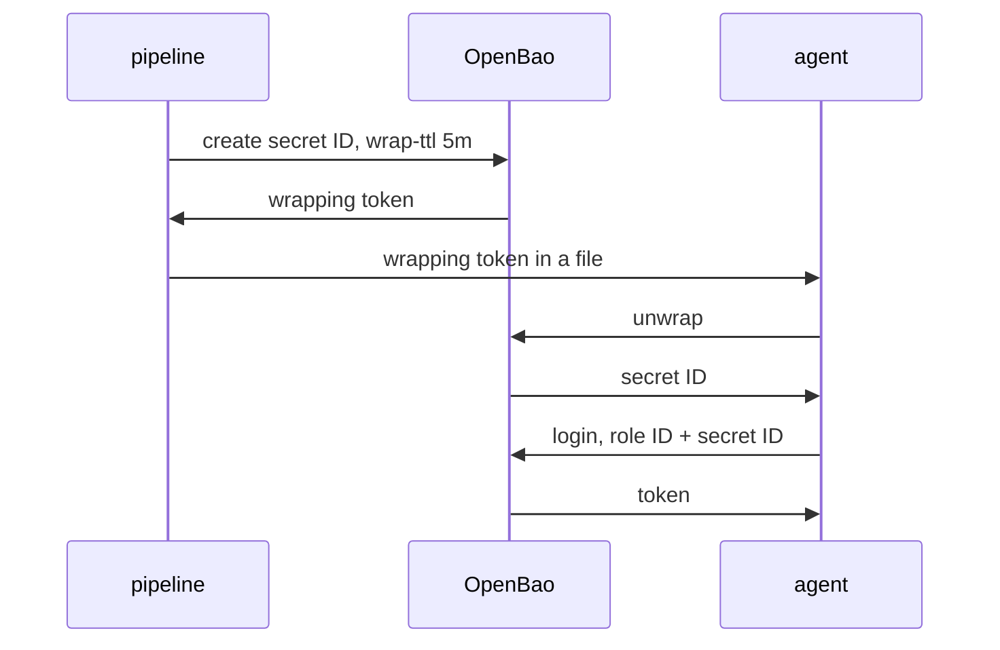

# Delivering A Secret ID Wrapped

A pipeline that creates a secret ID and passes it to a program has a problem: the secret ID is visible while it travels. Response wrapping removes that problem. OpenBao keeps the real secret ID and hands out a single-use wrapping token, and the agent exchanges the token for the secret ID itself.

The commands below need the port-forward from a second terminal, `BAO_ADDR` and `BAO_TOKEN` as in the previous part, and the role `nightly`.

## Creating a wrapped secret ID

Response wrapping means OpenBao stores a response in the cubbyhole of a new token and returns that token, the wrapping token, instead of the response. The cubbyhole is a private storage area that belongs to one token. Ask for the wrapping with the flag `-wrap-ttl`, which sends the header `X-Vault-Wrap-TTL`:

<!-- astrona:playground:renew -->

```sh
WRAPPING_TOKEN="$(bao write -wrap-ttl=5m -f -field=wrapping_token auth/approle/role/nightly/secret-id)"
echo "$WRAPPING_TOKEN"
```

The command prints only the wrapping token. The secret ID itself does not appear anywhere. The token works once and for five minutes.

## What the receiver checks

The receiver should check that the wrapping token came from the expected request before it uses it. The lookup endpoint does that and does not use the token:

```sh
curl -s -X POST --data "{\"token\":\"$WRAPPING_TOKEN\"}" "$BAO_ADDR/v1/sys/wrapping/lookup" \
  | jq '.data | {creation_path, creation_ttl}'
```

`creation_path` must be `auth/approle/role/nightly/secret-id`. If it names another path, someone replaced the token with a wrapped response from another request. `creation_ttl` is `300`, the five minutes asked for.

## Letting the agent unwrap

Unwrapping by hand would put the secret ID in a shell. Let the agent do it. In the AppRole method, `secret_id_response_wrapping_path` tells the agent that the file at `secret_id_file_path` holds a wrapping token, not a secret ID, and which path the wrapped response must come from. The agent checks the creation path, unwraps the token, and logs in with the secret ID inside. This is the method stanza:

```hcl
auto_auth {
  method "approle" {
    config = {
      role_id_file_path                   = "/etc/openbao-agent/role-id"
      secret_id_file_path                 = "/etc/openbao-agent/wrapped-secret-id"
      secret_id_response_wrapping_path    = "auth/approle/role/nightly/secret-id"
      remove_secret_id_file_after_reading = true
    }
  }
}
```

With `remove_secret_id_file_after_reading` set to `true`, which is the default, the agent deletes the file after it reads it. The wrapping token is used up and the file is gone, so nothing useful stays on disk. The agent logs in with the secret ID it got and then renews its token. When the token reaches its maximum lifetime, the agent must log in again and reads the file again, so the pipeline has to place a new wrapping token there before that time. A role with a longer `token_max_ttl` gives the pipeline more time.

## When the unwrap fails

Because a wrapping token works once, a failure is information:

- The unwrap fails because the token was used. Someone else unwrapped the secret ID first. Treat the secret ID and any token made from it as leaked, and issue a new one.
- The unwrap fails because the token expired. The `-wrap-ttl` was shorter than the delivery. Issue a new one and deliver it faster.
- The agent refuses the token because of the creation path. The token wraps a different response than `secret_id_response_wrapping_path`. Check how the pipeline created it.

The same flow works for any secret. A second part of the pipeline can wrap the role ID too, though the role ID is not secret.



The diagram shows that only the wrapping token travels between the pipeline and the agent, and that the agent obtains the secret ID directly from OpenBao.

You can now deliver a secret ID so that interception is visible, and configure the agent to unwrap it. AppRole is one method of several; the next question is which one fits a given workload.

## Common pitfalls

> [!WARNING]
> - **Unwrapping the token to test it.** Use `sys/wrapping/lookup`, which does not use it up.
> - **A long `-wrap-ttl` "to be safe".** It gives an attacker time. Use the shortest time the delivery needs.
> - **Forgetting `secret_id_response_wrapping_path`.** The agent then treats the wrapping token as a secret ID and the login fails.
> - **Reusing one wrapping token for two agents.** It works once, so the second agent fails.

## Your mission: Hand An Agent A Wrapped Secret ID

You can now create an AppRole with tight secret ID limits and deliver a secret ID as a wrapping token. The mission asks you to build such a role for a nightly job and to leave the role ID and an unused wrapping token in a Kubernetes Secret.

The lab runs in its own cluster, so first pause your playground. Nothing in it is lost:

```sh
astrona stop ats-116-playground-020-02
```

Then start the lab:

```sh
astrona run --git ssh://git@github.com/astrona-io/ATS116.git -c sections/section-020/module-02/labs/lab-01
```

The task is on the next page. Solve it on your own first. When you think you are done, send it for grading:

```sh
astrona submit -c sections/section-020/module-02/labs/lab-01
```

When the lab is done, remove it and start your playground again:

```sh
astrona destroy ats-116-lab-020-02
astrona start ats-116-playground-020-02
```
