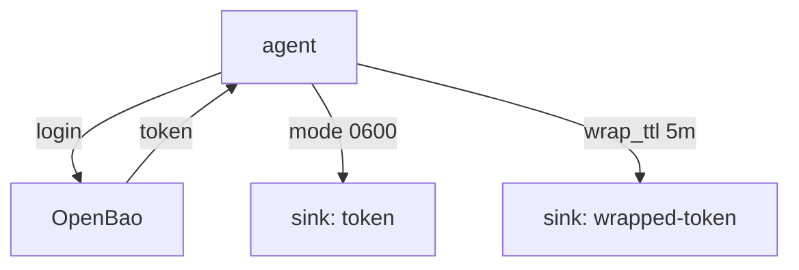

# Sink Options And Token Sharing

The agent's templates use its token directly. Sometimes another process in the pod also needs a token, for example a script that calls the OpenBao API. A sink writes the agent's token to a file for that process. This part shows how to protect that file, how to wrap what the sink writes, and how to use more than one sink.

The commands below need the playground's `inventory` pod in `agent-demo`.

## What a file sink writes

A sink receives the token after every login and writes it to its destination. The `file` sink is the type available in the playground. Its `config` takes the `path` and optionally a `mode`, the file permissions as an octal number. Without `mode` the file is readable by the owner and the group:

```hcl
sink "file" {
  config = {
    path = "/home/openbao/agent/token"
    mode = 0600
  }
}
```

Mode `0600` lets only the user that runs the agent read the file. Check the mode of the playground's sink file, and the user of the process:

<!-- astrona:playground:renew -->

```sh
kubectl -n agent-demo exec deploy/inventory -c agent -- ls -l /home/openbao/agent/token
kubectl -n agent-demo exec deploy/inventory -c agent -- id
```

The listing shows the owner and the permissions of the sink file. The second command shows the user and group of the shell in the agent's container, which is the user that owns the file. A second container that mounts the same volume reads the file only if its user matches the owner or the group allowed by the mode.

## Who sees the file

The sink file is a bearer credential: whoever reads it can call OpenBao with the agent's policies. In Kubernetes that means every container that mounts the volume, and everyone who can run `kubectl exec` in that container. Three habits reduce the risk:

- Mount the sink volume into the containers that need the token, and no others.
- Use an `emptyDir` volume, so the file never reaches a node's disk when the volume uses the memory medium.
- Give the agent's policy only the paths that the other process needs.

If no other process needs the token, remove the sink. The agent works without one.

## Wrapped sinks

A sink can ask OpenBao to wrap the token before it is written. Set `wrap_ttl` on the sink: the file then holds a wrapping token, and the consumer unwraps it once. A wrapping token written to a file only works once, so a second reader sees an error, which exposes a copy.

```hcl
sink "file" {
  wrap_ttl = "5m"
  config = {
    path = "/home/openbao/agent/wrapped-token"
  }
}
```

A wrapped sink changes the work of the consumer: it must unwrap the token with `sys/wrapping/unwrap` before the first use, and it must do so within the TTL. Because the agent writes a new token at each login, the consumer must read the file again after each login.

The sink can also encrypt the token for a consumer. Setting `dh_type = "curve25519"` and `dh_path` makes the agent run a key exchange with a public key the consumer writes to `dh_path`, and the sink holds an encrypted token that only the consumer can read. `derive_key` and `aad` tune that encryption. This is a rarely used option; most deployments rely on file permissions or on `wrap_ttl`.

## More than one sink

An `auto_auth` block can hold several `sink` stanzas. The agent writes the same token to each one. Two sinks are useful when two consumers need different handling, for example one plain file for a trusted sidecar and one wrapped file for a script that runs once. Each sink has its own `path`, `mode` and `wrap_ttl`.



The diagram shows one login producing one token that the agent writes to two sinks with different settings.

You can now protect, wrap and duplicate the token file. That completes the path from the first credential to the token in a file, and the agent keeps the token renewed for as long as it runs.

## Common pitfalls

> [!WARNING]
> - **Writing the sink to a volume shared with an untrusted container.** Anyone who reads the file has the token.
> - **Setting `wrap_ttl` on a sink and reading the file twice.** The second unwrap fails by design.
> - **Using a sink when only the templates need the token.** Remove it; the agent does not need it.
> - **Leaving the default mode and assuming the file is private.** Set `mode` to the narrowest value that works.
