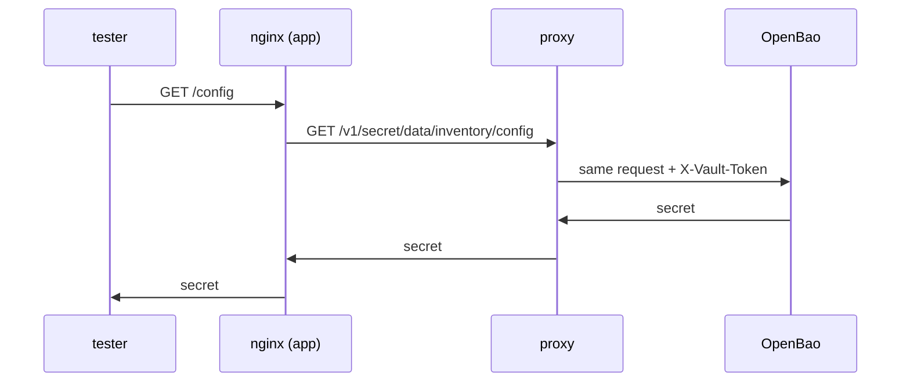

# The API Proxy And The Auto-Auth Token

An application that calls the HTTP API needs a token for every request. If that token sits in the application's configuration, it is a long-lived secret that anyone who can read the configuration can copy. This part shows how OpenBao Proxy removes the token from the application: the application sends requests without one, and the proxy adds its own.

## The proxy's configuration file

OpenBao Proxy reads an HCL configuration file, like the agent does. In this playground it comes from the ConfigMap `proxy-config`. Print it:

<!-- astrona:playground:renew -->

```sh
kubectl -n proxy-demo get configmap proxy-config -o jsonpath='{.data.proxy\.hcl}'
```

Four stanzas make it work:

| Stanza | What it does |
| --- | --- |
| `vault` | Where OpenBao is: `address = "http://openbao.openbao.svc:8200"` |
| `auto_auth` | How the proxy logs in: the `kubernetes` method with the role `inventory-proxy` |
| `api_proxy` | `use_auto_auth_token = true`: add the auto-auth token to requests that arrive without one |
| `listener "tcp"` | Where the proxy accepts requests: `127.0.0.1:8100`, without TLS |

The container starts it with `bao proxy -config=/etc/openbao-proxy/proxy.hcl`. Auto-auth works exactly as in OpenBao Agent: the proxy sends the pod's service account token to the Kubernetes auth method, and the role turns it into an OpenBao token with the policy `inventory-reader`. Unlike the agent, the proxy needs no sink, because it uses the token itself for every request it forwards.

## One request through the proxy

The application here is `nginx`, set up to forward `/config` to the proxy. Follow one request from the `tester` pod:

```sh
kubectl -n clients exec deploy/tester -- curl -s http://inventory.proxy-demo/config | jq '.data.data'
```

The fields of `secret/inventory/config` come back. The request took three hops, and only the last one carried a token:



The diagram shows `nginx` sending a request without a token to the proxy on `127.0.0.1:8100`, and the proxy adding its auto-auth token before it forwards the request to OpenBao. Send the same request from inside the app container, the way any program in the pod would:

```sh
kubectl -n proxy-demo exec deploy/inventory -c app -- \
  wget -qO- http://127.0.0.1:8100/v1/secret/data/inventory/config
```

The same JSON comes back. The request had no token, and OpenBao still answered, because the proxy added one.

## When the caller brings its own token

`use_auto_auth_token = true` adds the proxy's token only when a request has none. If the request carries an `X-Vault-Token` header, the proxy forwards that token instead, and OpenBao applies that token's policies. Send a request with a token that does not exist:

```sh
kubectl -n proxy-demo exec deploy/inventory -c app -- \
  wget -S -qO- --header "X-Vault-Token: not-a-real-token" \
  http://127.0.0.1:8100/v1/secret/data/inventory/config
```

This time OpenBao refuses the request with `403`, because the proxy forwarded the caller's token as it was. With `use_auto_auth_token = "force"`, the proxy would replace any token in the request with its own. Choose `"force"` only when every client of the proxy must act as the proxy's identity; `true` lets a client with its own token keep its own, usually wider or narrower, rights.

## Proxy or agent

OpenBao Proxy and OpenBao Agent share auto-auth, but they serve different applications. Pick by what the application does today:

| The application... | Use |
| --- | --- |
| reads a configuration file or environment variables | OpenBao Agent with templates |
| already calls the HTTP API, or uses an OpenBao client library | OpenBao Proxy |
| needs both | Agent and proxy as two containers, or one of each process |

You now know how the proxy logs in, how it adds its token only to requests without one, and how a request flows from the application to OpenBao. That raises the question every proxy deployment must answer: who else can send requests to this proxy?

## Common pitfalls

> [!WARNING]
> - **Assuming the proxy always uses its own token.** With `use_auto_auth_token = true`, a request that carries a token is forwarded with that token. A stale token in the application then causes `403`.
> - **Using `"force"` without thinking.** It turns every client's request into the proxy's identity, including clients that should have had less access.
> - **Looking for a sink.** The proxy uses its token internally; a sink is optional and only useful if another process needs the token.
> - **Forgetting the KV version 2 path.** Requests through the proxy are raw HTTP requests, so `data/` must be in the path.
