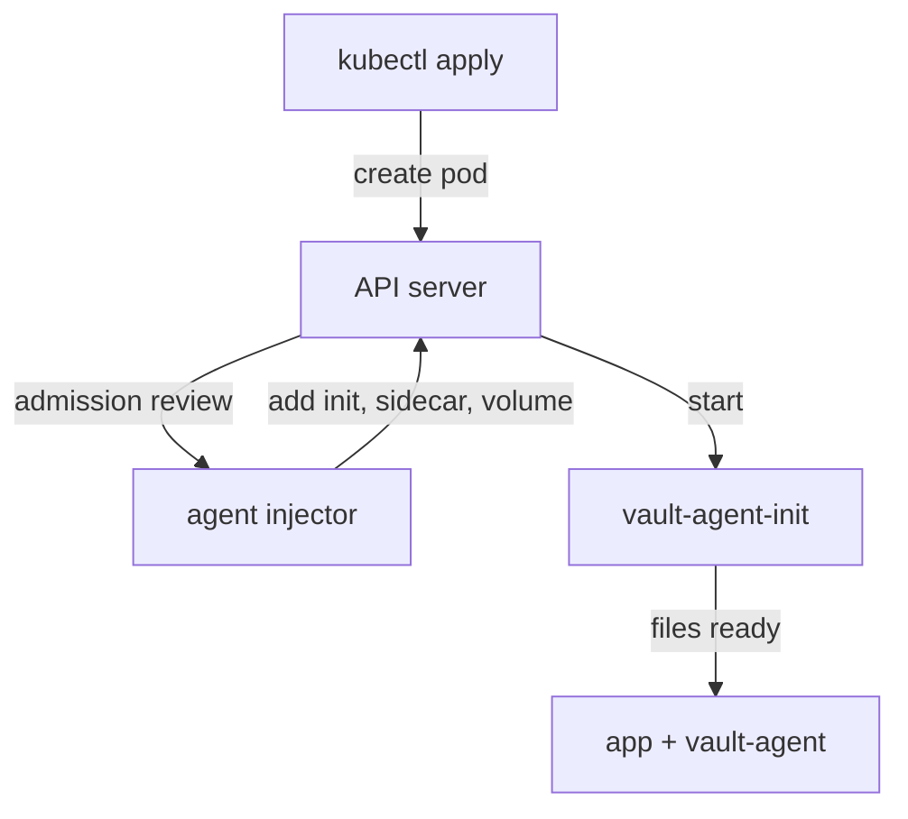

# How The Agent Injector Works

Before you write annotations, you need to know which component reads them and what it does to a pod. Otherwise a pod without secrets is a mystery: was it never changed, or was it changed and its agent failed? This part looks at what the Helm chart installed, at the change the injector makes to a pod, and at the names it uses, which all still say `vault`.

## What the chart installed

The `openbao` Helm chart installs the injector next to the OpenBao server when its value `injector.enabled` is `true`. Look at both:

<!-- astrona:playground:renew -->

```sh
kubectl -n openbao get deployment openbao-agent-injector -o jsonpath='{.spec.template.spec.containers[0].image}{"\n"}'
kubectl get mutatingwebhookconfiguration openbao-agent-injector-cfg -o jsonpath='{.webhooks[0].name}{"  "}{.webhooks[0].failurePolicy}{"\n"}'
```

The injector runs the image `hashicorp/vault-k8s:1.7.6`. The webhook configuration `openbao-agent-injector-cfg` tells the Kubernetes API server to call the injector for every new pod, and its `failurePolicy` is `Ignore`: if the injector does not answer, Kubernetes creates the pod unchanged rather than refusing it.

## Why the names say vault

OpenBao started as a fork of HashiCorp Vault, and the injector is a case where the old names are still everywhere. The chart's default injector image is HashiCorp's `vault-k8s`. OpenBao has its own fork, `openbao-k8s`, but it publishes no container image yet, so the chart uses `vault-k8s`, and so does this course. Three things follow:

- The annotations start with `vault.hashicorp.com/`, for example `vault.hashicorp.com/agent-inject`. The `openbao-k8s` code uses the same prefix, so these annotations will keep working when it ships.
- The secrets appear in `/vault/secrets/` inside every container of the pod.
- The injected containers are called `vault-agent-init` and `vault-agent`, and they run the command `vault agent`.

The agent itself is OpenBao. The chart sets the injected image to `quay.io/openbao/openbao:2.7.1`, and that image contains a link named `vault` that points at the `bao` program, so `vault agent` starts OpenBao Agent 2.7.1. Some OpenBao documentation pages show the prefix `openbao.openbao.com/` and the path `/openbao/secrets`. No released injector uses them, so this course does not either.

## What the injector changes in a pod

The injector changes only pods that carry the annotation `vault.hashicorp.com/agent-inject: "true"`. For those, it adds three things: a shared in-memory volume mounted at `/vault/secrets` in every container, an init container `vault-agent-init` that logs in and writes the secrets before the application starts, and a sidecar container `vault-agent` that keeps them up to date while the pod runs.



The diagram shows the API server asking the injector to change a new pod, then starting the init container before the application and its sidecar. Look at the result in the playground's pod:

```sh
kubectl -n inventory get pod -l app=inventory -o jsonpath='init: {.items[0].spec.initContainers[*].name}{"\n"}containers: {.items[0].spec.containers[*].name}{"\n"}'
```

The pod has the init container `vault-agent-init` and two containers, `app` and `vault-agent`, although the Deployment lists only `app`. The injector added the rest. Ask the application for its file:

```sh
kubectl -n clients exec deploy/tester -- curl -s http://inventory.inventory/config
```

Three lines come back, `DB_HOST=`, `DB_USER=` and `API_KEY=`, rendered by the injected agent into `/vault/secrets/config.env`. `nginx` read a file and knows nothing else.

## Injector, sidecar or proxy

The injector writes the same OpenBao Agent configuration you could write yourself, from annotations instead of a file. Choose by who owns the pod:

| Option | Fits when |
| --- | --- |
| Agent injector | Many teams deploy applications that read files; the platform team runs the injector once |
| Agent sidecar written by hand | You need agent options the annotations do not cover, or the cluster has no injector |
| OpenBao Proxy sidecar | The application already calls the HTTP API |

You now know which component injects the agent, why its names say `vault`, what it adds to a pod, and how to see that a pod was injected. The open question is how the annotations describe which secret to render and in what form.

## Common pitfalls

> [!WARNING]
> - **Expecting `openbao.openbao.com/` annotations to work.** The injector the chart installs reads only `vault.hashicorp.com/` annotations; anything else is ignored silently.
> - **Forgetting `failurePolicy: Ignore`.** A pod created while the injector was down starts without an agent, and nothing reports it. Delete the pod once the injector runs.
> - **Looking for the agent in the Deployment.** The injector changes the pod, not the Deployment. Read the pod's spec.
> - **Looking for secrets in `/openbao/secrets`.** With this injector they are in `/vault/secrets`.
