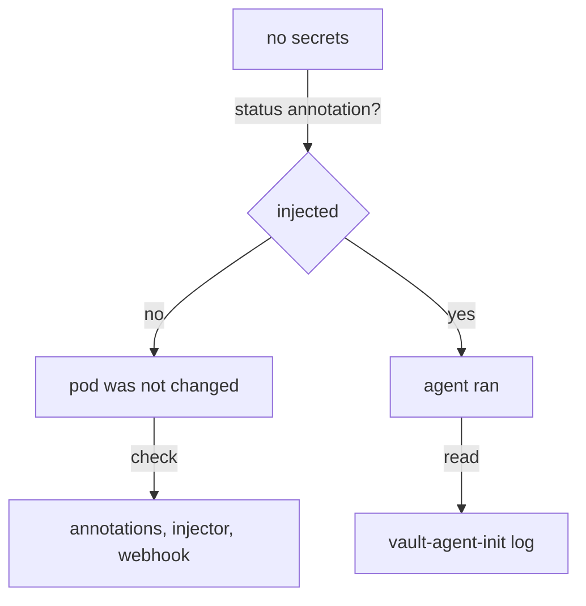

# Troubleshooting Injection

When an injected application has no secrets, there are only a few possible stories, and they look alike from the outside: the application answers `404` or never starts. This part gives you one question that splits them into two groups, and a command for each step after that, so you fix the actual cause instead of guessing.

The commands below use the playground's `inventory` pod in the namespace `inventory`.

## The first question: was the pod injected?

The injector marks every pod it changes with the annotation `vault.hashicorp.com/agent-inject-status: injected`. A pod without it was never changed, and nothing about OpenBao can be the cause yet. Ask the running pod:

<!-- astrona:playground:renew -->

```sh
POD="$(kubectl -n inventory get pods -l app=inventory -o jsonpath='{.items[0].metadata.name}')"
kubectl -n inventory get pod "$POD" -o jsonpath='{.metadata.annotations.vault\.hashicorp\.com/agent-inject-status}{"\n"}'
```

The playground's pod answers `injected`. The rest of the search depends on this answer:



The diagram shows the status annotation splitting the search into pods the injector never changed and pods whose agent ran and failed.

## When the pod was not injected

A pod that was not injected has only the containers its Deployment lists. Three causes are common:

| Cause | How to tell |
| --- | --- |
| The annotations are on the Deployment, not on the pod template | `kubectl get deployment -o jsonpath='{.spec.template.metadata.annotations}'` is empty |
| The annotation value is not the string `"true"`, or the prefix is not `vault.hashicorp.com/` | Compare the keys and values with the table of annotations |
| The injector was not running when the pod was created | The webhook's `failurePolicy` is `Ignore`, so Kubernetes created the pod unchanged |

For the third cause, the injector's own log shows whether it received the pod at all:

```sh
kubectl -n openbao logs deploy/openbao-agent-injector | tail -n 20
```

The injector logs the admission requests it handles, so an empty log for the time the pod was created means it never saw the pod. Once the cause is fixed, delete the pod or restart the Deployment: the injector changes pods only when they are created.

## When the pod was injected and still has no secrets

An injected pod runs `vault-agent-init` first, and the application starts only after it finishes. If the init container cannot log in or cannot render, it keeps trying, and the pod stays in `Init:0/1`. Its log names the reason:

```sh
kubectl -n inventory logs "$POD" -c vault-agent-init | tail -n 20
```

In the playground the log shows a successful login and render. In a broken pod, three messages are typical. A login refused with `permission denied` means the role does not bind the pod's service account and namespace. A render refused with `permission denied` means the role's policy does not allow the secret path. A file that contains `<no value>` means the template reads a field at the wrong depth; that pod starts, because nothing failed. After the init container is done, the same reasons appear in the sidecar's log, `-c vault-agent`.

## Other ways to deliver secrets in Kubernetes

The injector is one of three Kubernetes integrations the OpenBao project describes. They differ in where the secret ends up:

| Integration | The secret ends up in |
| --- | --- |
| Agent injector | A file in an in-memory volume of the pod, kept up to date by a sidecar |
| CSI provider | A file in a volume mounted through the Secrets Store CSI driver, written when the pod starts |
| Secrets operator | A normal Kubernetes Secret that an operator keeps in sync with OpenBao |

The secrets operator puts the value into a Kubernetes Secret, which anyone allowed to read Secrets in that namespace can read. The injector and the CSI provider keep it inside the pod.

You can now tell a pod the injector never changed from an injected pod whose agent failed, and find the cause of each with one or two commands. That completes the path from an annotation to a file the application reads.

## Common pitfalls

> [!WARNING]
> - **Reading the application's log first.** In an injected pod that is stuck, the application has not even started. Read `vault-agent-init`.
> - **Fixing the annotations and waiting.** Existing pods are never injected again. Delete them or restart the Deployment.
> - **Assuming an injector outage is visible.** With `failurePolicy: Ignore`, pods start without an agent and nothing reports it. Check the status annotation.
> - **Treating `Init:0/1` as a scheduling problem.** It almost always means the agent cannot log in or read the secret.
